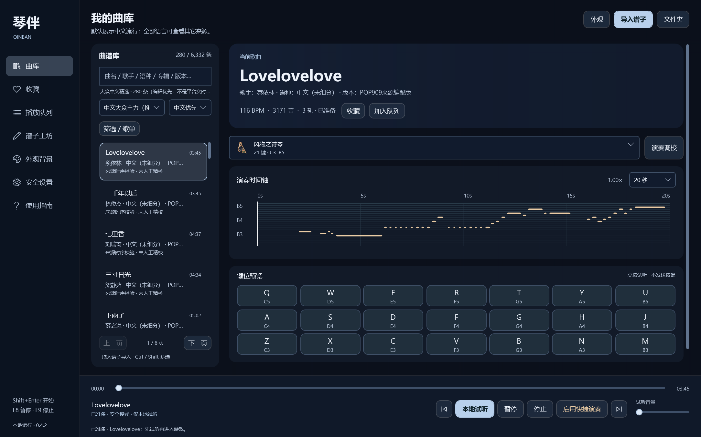
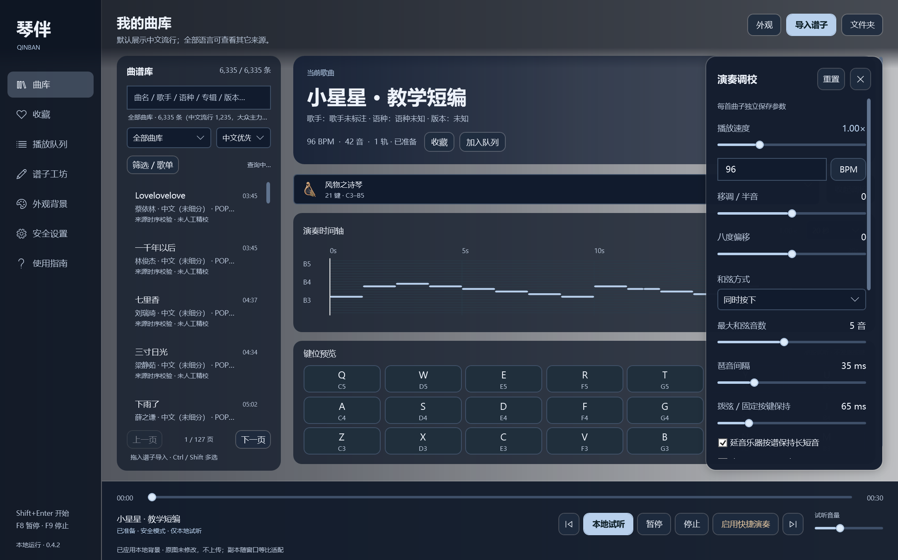

# 琴伴 QinBan

### 原神演奏工作台 · 选谱、试听、调校，再开始演奏

琴伴是一款 Windows 桌面软件，把本地曲谱管理、音符时间轴、乐器键位预览和演奏参数集中在同一个工作台。先在电脑上试听，再由你主动授权向选定的原神前台窗口演奏。

**Windows x64 · WPF / .NET 10 · 本地运行 · GPL-3.0**

[使用指南](README-QINBAN.md) · [源码构建](docs/DEVELOPMENT.md) · [问题反馈](https://github.com/Anyes666/Qinban/issues) · [来源与许可](QINBAN-NOTICES.md)



*真实采集自琴伴 0.4.2 运行程序，不是上游演示或概念图。截图中的 6,332 条是本机曲库，不是本仓库附送的歌曲；曲谱仍有未人工精校、未游戏验收和未清权候选。*

## 在一个工作台里完成演奏准备

| 功能 | 如何使用 |
| --- | --- |
| **我的曲库** | 按曲名、歌手、语种、专辑或版本检索；筛选、分页查看谱目 |
| **本地试听** | 先听节奏与旋律，再对照音符时间轴和乐器键位 |
| **演奏调校** | 调整速度、BPM、移调、八度、和弦方式、轨道和循环范围 |
| **收藏与队列** | 收藏常用谱目，组织本地试听顺序；不会自动连续发送游戏按键 |
| **谱子工坊** | 新建文本谱、校验内容、保存副本、导出谱子 |
| **外观背景** | 使用纯净深色或本地图像，调整暗化、模糊与显示方式 |
| **安全设置** | 选择原神窗口，确认本次授权；仅向指定前台窗口输出 |



*真实界面自测截图，采用测试生成的纯色背景与教学短编。测试目录中包含额外测试谱，显示数量不代表生产曲库新增。详见[截图说明](docs/SCREENSHOTS.md)。*

## 第一次使用：五步开始

1. **打开琴伴**：已有完整运行包时，解压到可写目录，运行 `QinBan.exe` 或 `Start-QinBan.cmd`。没有运行包请按[构建指南](docs/DEVELOPMENT.md)从源码构建。
2. **导入或选择谱子**：支持 `.mid`、`.midi`、文本谱 `.txt` 和受支持结构的 `.json`。也可在“谱子工坊”创建第一份练习谱。
3. **选好乐器，先试听**：在下拉框中选择与游戏内一致的乐器，点击“本地试听”。本地合成音色不是游戏原声。
4. **按需调校**：打开“演奏调校”，调整速度、移调、轨道或和弦方式，确认时间轴与键位预览。
5. **主动开始游戏演奏**：在“安全设置”选择原神窗口并确认风险，点击“启用快捷演奏”。回到该游戏窗口、打开对应乐器、关闭聊天后，按 **Shift+Enter**，松开两键即开始。

| 快捷键 | 作用 |
| --- | --- |
| **Shift+Enter** | 已授权且目标游戏在前台时，松键开始当前谱子，无倒计时 |
| **F8** | 暂停 / 继续 |
| **F9** | 停止演奏并请求释放按键 |

> 程序无法判断游戏内部是否处于聊天或菜单。切换离开目标窗口会中断游戏演奏。鼓类等待核验配置不会开放自动演奏；不要把键位适配或软件测试当成游戏规则、安全性或逐曲效果保证。

## 获取与构建

**当前 GitHub 仓库提供源码，没有已发布的琴伴安装包。** 本地完整版、个人 `UserData`、原始采集材料和完整曲库不随源码公开，也不引用上游下载包充当琴伴发行版。

Windows 上安装 .NET 10 SDK、Git 和 Python 3 后：

```powershell
git clone https://github.com/Anyes666/Qinban.git
cd Qinban

# 仅在全新克隆中生成 30 份教学短编，不下载商业歌曲
python .\tools\generate_builtin.py
.\build-qinban.ps1 -Mode build
dotnet run --project .\QinBan.Desktop -c Release
```

已有 `Songs` 曲库时**不要直接运行教学谱生成器**，它会写入固定文件名。测试、自包含打包和数据备份方法见[构建指南](docs/DEVELOPMENT.md)及[使用指南](README-QINBAN.md)。

## 公开范围与项目归属

- 产品入口：`QinBan.slnx` / `QinBan.Desktop`。根目录的 `AutoMidiPlayer.*` 是保留的上游参考，不是琴伴启动入口。
- 琴伴为独立 GPL 派生项目，保留 [Jed556/AutoMidiPlayer](https://github.com/Jed556/AutoMidiPlayer) 的源码和归属，不是其官方发行版，也不是 HoYoverse 官方产品。
- 代码许可不替曲谱、背景原画或游戏图标清权；公开分发素材或曲谱需要单独确认权利。参见 [LICENSE](LICENSE)、[来源与许可](QINBAN-NOTICES.md)和[发布范围](REPOSITORY-PUBLISHING-SCOPE.md)。
- 历史研发记录保存在 [docs/history](docs/history/README-QINBAN-20261008.md)，不作为当前操作指南或发布承诺。

## 本次展示验证

2026-10-10：本地 0.4.2 自包含程序冷启动通过（6,332 / 6,332），界面自测 **69 / 69**，真实按键发送尝试 **0**。这是软件级验证，不是逐曲音乐质量或原神内演奏验收。截图来源、哈希和验证边界见[截图说明](docs/SCREENSHOTS.md)。
